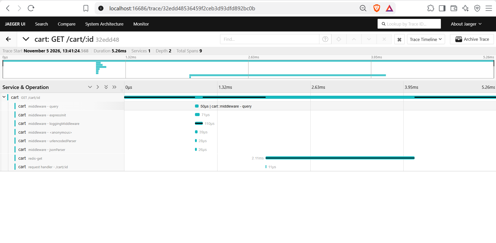

# Capstone 2: Keep It Running (Stan's Robot Shop)

Forked from `instana/robot-shop` and run on the local `kind` cluster from Capstone 1 (my AWS account blocks EKS, so the cluster is local).

## Status

| Step | Status |
|---|---|
| 1. Deploy and watch (Robot Shop + load generator) | Done |
| 2. Metrics: kube-prometheus-stack + one dashboard | Done (monitoring/) |
| 3. Logs: Fluent Bit to Loki | Done, searchable by service |
| 4. One trace in Jaeger | Done: cart traced with OpenTelemetry |
| 5. SLO, error budget policy, Slack alert | Done (SLO.md, RUNBOOK.md) |
| 6. Incident drill and postmortem | Done (POSTMORTEM.md, drill/timeline.txt) |

## Step 1: Deploy Robot Shop

```bash
kubectl create namespace robot-shop
helm install robot-shop K8s/helm --namespace robot-shop
kubectl -n robot-shop apply -f K8s/load-deployment.yaml
```

### Changes I made to the chart

- **Removed the Instana agent settings** (`INSTANA_AGENT_HOST`) from the cart, catalogue, dispatch, payment and user deployments. The web deployment's Instana settings only render when an EUM key is set, and I left it unset.
- **Raised memory limits** for MySQL (1 GiB to 2 GiB) and RabbitMQ (512 MiB to 1 GiB).

### Problems I hit and how I fixed them

- **MySQL and RabbitMQ were killed within seconds of starting (`OOMKilled`, exit code 137)** even after raising their limits. The node's container runtime was giving every container an open-files limit of about 2 billion, which makes these programs allocate far more memory than their limits allow. Fix: I set `LimitNOFILE=1048576` for `containerd` inside the kind node and recreated the pods. This lives in the node, not in the chart, so it has to be repeated if the cluster is recreated.
- **Images stuck in `ContainerCreating` / `ImagePullBackOff`** because the node could not download them on my connection. Fix: I pulled each image on my machine and copied it into the cluster with `kind load`.
- **The cluster hung** (API timeouts) while many images unpacked at once. Fix: restarting WSL and the node container.

## Known limits

- The dashboard has no request-rate, error-rate or latency panels, because Robot Shop does not export request metrics. The panel labelled "latency" shows CPU.
- The SLI is pod readiness, not request success.
- Prometheus and Loki use temporary storage, so history is lost when they restart.
- Logs have a `service` label but no `level` label, so level is a text filter.

## Step 4: One trace in Jaeger

Jaeger and an OpenTelemetry Collector run in the `monitoring` namespace (`monitoring/tracing/`). I instrumented one service, `cart`, with OpenTelemetry's Node.js auto-instrumentation, which needed these changes:

- Removed the Instana collector from `cart/server.js` (it was loaded unconditionally).
- Rebuilt the image on Node 18 with `@opentelemetry/auto-instrumentations-node@0.56.1` (the latest version needs Node 22). Image tag `rs-cart:otel`.
- Pointed `cart` at the collector with environment variables in the Helm chart, and raised its memory limit from 100 MiB to 256 MiB.

I sent a real request through the shop (`GET /api/cart/cart/trace-test`) and found it in Jaeger as `cart: GET /cart/:id`: 9 spans (Express middleware, a `redis-get` call and the request handler), no errors.



**Limits:** only `cart` is instrumented, so the trace covers that one service and its Redis call, not a path across web, catalogue and payment. The instructor's script (`trace_critical_workflow.py`) was not used, because it generates a made-up trace and does not trace the shop.
